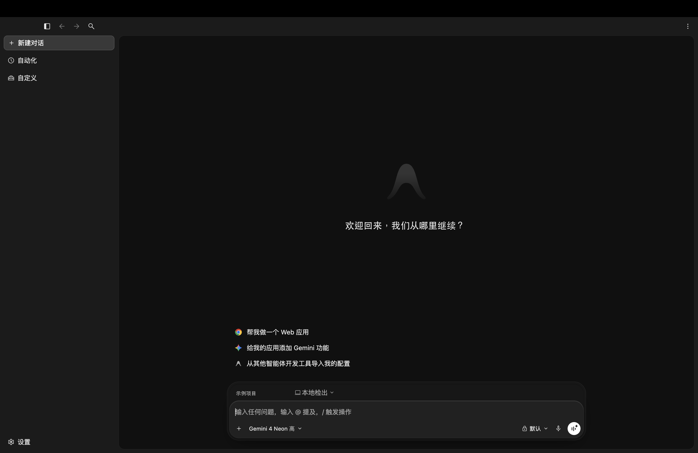

# Antigravity 中文汉化工具箱 · 可一键恢复

> **Cross-platform, reversible Simplified Chinese localization for the Google Antigravity desktop app.**
> 非官方汉化方案，支持 **macOS / Windows / Linux**，**修改前自动备份，随时可完整回滚**。



> 截图已脱敏：历史会话列表、工作区名称与账号名均已遮盖，仅用于展示汉化效果。

## 为什么做这个项目

Google Antigravity 桌面客户端目前没有官方中文语言包。社区已有很好的注入式汉化方案，但普遍存在两个问题：升级后汉化失效、以及**改坏了不好恢复**。本项目在社区方案之上补齐了：

- **两层备份**：官方原版 `app.asar.bak` + 整个应用程序的完整快照。
- **一套跨平台管理命令**：`status / install / backup-full / restore / restore-full`，任何修改前都要求应用已退出。
- **macOS 完整回滚能把 Google 官方签名一起恢复**（普通还原做不到，因为重签名会变成 ad-hoc）。
- **官方升级后的自动重新备份**：整包快照按版本号分别保存，不会用旧版本覆盖新版本。

## 特性

- 5992 条简体中文词条 + DOM 实时翻译引擎（`MutationObserver`），覆盖主界面、设置、侧栏、弹窗、错误提示。
- 原生菜单、系统托盘菜单、退出确认弹窗一并汉化。
- 保留模型名、斜杠命令（`/goal`）、品牌名；AI 生成的思考链正文不逐词硬翻，避免中英夹杂。
- 针对 2.33.x 新增的欢迎页文案与**随机轮播问候语**做了动态规则适配。
- **词典热重载**：编辑 `~/.antigravity-zh/zh-CN.json` 后自动生效，不用重装、不用重启。
- 纯 Python 标准库实现，**零第三方依赖、无网络请求、无后台驻留、不改动用户数据**。

## 支持矩阵

| 平台 | 默认 `app.asar` 位置 | 管理命令 | 签名处理 |
| --- | --- | --- | --- |
| macOS | `/Applications/Antigravity.app/Contents/Resources/app.asar` | `./ag-zh …` | 修改后自动 ad-hoc 重签名；`restore-full` 恢复 Google 官方签名 |
| Windows | `%LOCALAPPDATA%\Programs\Antigravity\resources\app.asar` | `ag-zh.cmd …` | 无需重签名（`Antigravity.exe` 的 Authenticode 签名不受影响） |
| Linux | `/opt/Antigravity/resources/app.asar` 等 5 个候选 | `./ag-zh …` | 无需重签名 |

自定义安装位置：用 `--asar PATH` 或设置环境变量 `AGZH_ASAR`。Windows 还会读取注册表卸载项里的 `InstallLocation` 自动定位。

## 前置条件

- Python **3.8+**（Windows 上 `python` 或 `py -3` 会自动探测）。
- 执行修改类命令前**完全退出 Antigravity**（macOS `Cmd+Q`；Windows 托盘图标右键退出）。脚本会检测并拒绝操作。
- macOS 需要对 `/Applications` 有写权限。

## 快速开始

### macOS / Linux

```bash
git clone https://github.com/kaivenw/antigravity-zh-toolkit.git
cd antigravity-zh-toolkit

./ag-zh status      # 先看状态
./ag-zh install     # 首次会自动做整包备份，然后汉化
```

`install` 会把未修改的应用完整备份到 `~/.antigravity-zh-backup/Antigravity-<版本>.app`（约几百 MB），再修改 `app.asar`。也可以单独执行 `./ag-zh backup-full`。

### Windows

```bat
git clone https://github.com/kaivenw/antigravity-zh-toolkit.git
cd antigravity-zh-toolkit

ag-zh.cmd status
ag-zh.cmd install
```

`ag-zh.cmd` 会自动选择 PowerShell 7 或系统自带的 Windows PowerShell 5.1，并处理执行策略。也可以直接用 Python：

```bat
python install.py
python install.py --restore
python install.py --status
python install.py --info
```

## 命令一览

| 命令 | 作用 |
| --- | --- |
| `status` | 查看版本、汉化状态、SHA256、备份校验、签名 |
| `install` | 安装 / 刷新汉化（官方升级后重跑）；自动补齐备份 |
| `backup-full` | 单独创建当前应用状态的整包快照 |
| `restore` | 还原英文原版：只把 `app.asar` 换回官方原版 |
| `restore-full` | 整包回滚：连同签名、目录结构一起恢复；当前版本改名保留不删除 |
| `help` | 显示帮助 |

环境变量：`AGZH_ASAR`（自定义 asar 路径）、`AGZH_BACKUP_ROOT`、`AGZH_PYTHON`、`AGZH_FULL_BAK`（用于演练恢复流程）。

## 恢复能力说明

- **`restore`（快）**：从 `app.asar.bak` 还原，SHA256 校验通过后即回到英文原版。macOS 上签名仍是 ad-hoc，功能不受影响。
- **`restore-full`（彻底）**：先校验整包备份，把当前应用目录改名为 `…agzh-old-<时间戳>`，再从快照复制回来，最后校验 asar 哈希；macOS 上 Google 的 Developer ID 签名也随之恢复。失败会自动回滚，旧目录不会被删除。
- **官方升级后**：升级器会覆盖 `app.asar`，汉化失效。重新运行 `install` 即可；脚本发现版本号变化会为新版本建立新的整包备份，旧备份保留。

> `restore-full` 会把应用回退到备份时的版本。如果只想回到英文界面而保留当前版本，用 `restore`。

## 工作原理

1. 用纯 Python 的 `asar.py` 解包 `app.asar`。
2. 向 `dist/preload.js`、`dist/ideInstall/wizardPreload.js` 注入翻译引擎与全量词典。
3. 向 `dist/menu.js`、`dist/tray.js`、`dist/main.js` 注入原生菜单 / 托盘 / 退出弹窗的翻译。
4. 重新打包，`chrome-devtools-mcp` 保持 `unpacked`。
5. 原子替换 `app.asar`；仅 macOS 执行 `codesign --force --deep --sign -`。
6. 把词典复制到 `~/.antigravity-zh/zh-CN.json` 供热重载。

引擎会跳过 `thinking-collapsible`、`planner-response-text`、`artifact-view` 等容器，避免把 AI 输出翻译得支离破碎。

## 自定义词条

编辑 `~/.antigravity-zh/zh-CN.json`（`"英文原文": "中文译文"`），保存后引擎会通过 `fs.watch` 自动重载并重新翻译当前页面。想让改动随仓库分发，请同时修改 `dicts/zh_cn.json` 并运行 `install`。

欢迎提 PR 补充新版本漏翻的词条。

## 常见问题

**Q：macOS 提示「应用已损坏，无法打开」？**
A：`sudo xattr -rd com.apple.quarantine /Applications/Antigravity.app`。

**Q：汉化后界面没变化？**
A：确认已完全退出并重新启动（不是最小化）。部分新版本新增文案可能未被词典覆盖，可编辑热重载词典。

**Q：重启后又变回英文了？**
A：部分版本会在**退出时静默安装已下载的更新**，覆盖 `app.asar`。重新运行 `install` 即可；若频繁发生，可在 Antigravity 设置里关闭自动更新。用 `status` 可以随时确认当前是汉化版还是原版。

**Q：macOS 自动更新异常？**
A：先 `./ag-zh restore-full` 恢复官方签名，完成升级后再 `./ag-zh install`。

**Q：Windows 上找不到 `app.asar`？**
A：`ag-zh.cmd status` 会列出探测结果；自定义目录用 `set AGZH_ASAR=D:\path\resources\app.asar`。

## CI（可选）

仓库自带 `tests/selftest.py`，GitHub Actions 工作流模板放在 **`ci/ci.yml`**（三平台矩阵：Ubuntu / macOS / Windows，含 PowerShell 语法解析校验）。本地随时可跑：

```bash
python tests/selftest.py
```

工作流模板没有直接放在 `.github/workflows/`，是因为通过 GitHub CLI 的 OAuth 令牌推送该目录需要额外的 `workflow` 权限。启用方式（在克隆后的仓库里）：

```bash
gh auth refresh -s workflow   # 仅当令牌缺少 workflow 权限时需要
./enable-ci.sh                # 把模板放到 .github/workflows/ci.yml 并推送
```

当然也可以直接在 GitHub 网页上新建 `.github/workflows/ci.yml`，内容复制 `ci/ci.yml`。

## 与上游的关系

本项目基于 [zhonghugo/antigravity-zh](https://github.com/zhonghugo/antigravity-zh)（MIT，v1.3.1）的翻译引擎、asar 库与词典。我们新增了跨平台支持、可恢复机制、管理脚本、2.33.x 词条与动态规则、自检测试与 CI。完整署名见 [CREDITS.md](CREDITS.md)。

## 免责声明

本项目与 Google 及 Antigravity 官方团队无关，不包含任何 Antigravity 二进制内容。修改 `app.asar` 可能违反官方服务条款，请自行评估使用风险。所有修改都在本机完成，均可按上述命令撤销。

## 许可证

[MIT](LICENSE) — 上游版权声明保留于 [LICENSE.upstream](LICENSE.upstream)。
